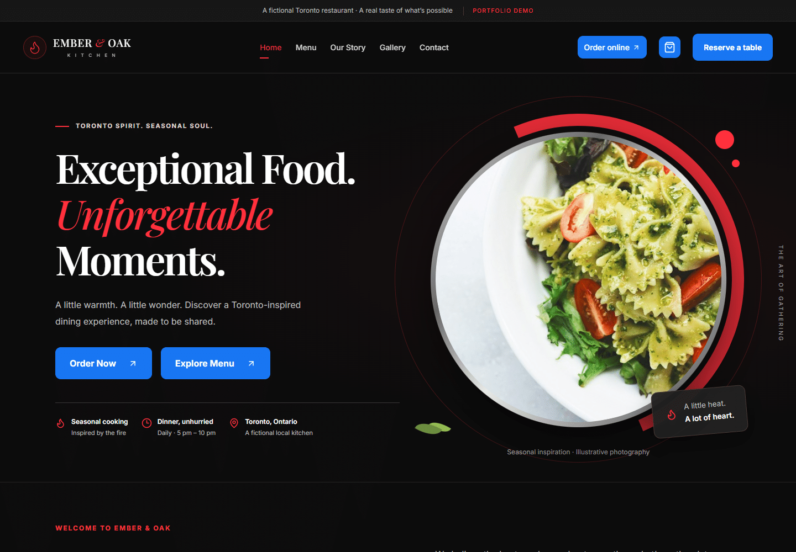
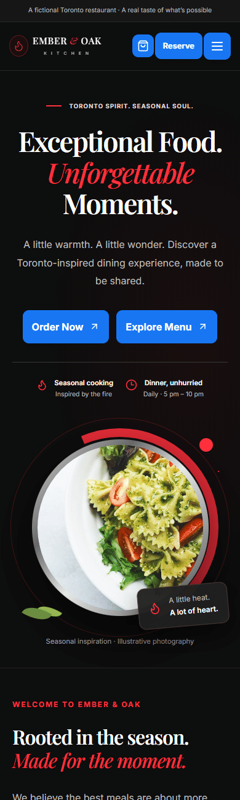

# Ember & Oak Kitchen

**Exceptional Food. Unforgettable Moments.**

A responsive restaurant website concept for a fictional premium kitchen in Toronto, Ontario. Built with React, it combines a cinematic dark interface with practical menu discovery, a persistent cart, and clearly labelled demo booking and checkout flows.

**[View Live Demo →](https://ember-oak-restaurant-rho.vercel.app)** · [GitHub Repository](https://github.com/awaljanhematyar/ember-oak-restaurant)

> Portfolio demonstration only. Reservations, ordering, checkout, and contact submissions do not reach a restaurant. No bookings are confirmed and no payments are processed.

[Overview](#overview) · [Features](#key-features) · [Stack](#technology-stack) · [Screenshots](#screenshots) · [Setup](#installation-and-local-development) · [Scripts](#available-npm-scripts) · [Structure](#project-structure) · [Limitations](#demo-limitations) · [Author](#author)

## Overview

Ember & Oak Kitchen demonstrates a complete restaurant browsing experience, from exploring seasonal dishes to requesting a table or completing a simulated order. The interface uses a near-black palette, red decorative accents, blue action buttons, circular food photography, and Playfair Display and Inter typography.

| Route | Experience |
| --- | --- |
| `/` | Brand introduction and featured dishes |
| `/menu` | Searchable, filterable menu |
| `/order` | Menu browsing with ordering context |
| `/reservations` | Validated demo reservation request |
| `/cart` | Quantities, item removal, and order totals |
| `/checkout` | Simulated pickup or delivery checkout |
| `/about` | Fictional restaurant story |
| `/gallery` | Photo gallery with keyboard-accessible lightbox |
| `/contact` | Demo contact form and labelled Toronto map |
| Other paths | Custom 404 page |

## Key Features

- **Menu discovery:** 24 sample dishes with CAD prices, dietary labels, availability, and combined text, category, and dietary filters.
- **Persistent cart:** quantity controls, removal, empty states, and versioned `localStorage` persistence with recovery for unavailable or corrupt storage.
- **Reservation demo:** Toronto-aware date and dinner-time validation, guest counts, and locally saved request metadata.
- **Checkout demo:** pickup and delivery options, Canadian postal-code validation, itemized totals, illustrative 13% HST, and a simulated receipt.
- **Responsive navigation:** mobile menu, active route links, and shared cart feedback.
- **Accessibility features:** skip link, labelled controls, validation feedback, keyboard focus handling, and gallery arrow-key, Tab, and Escape support.
- **Contact and imagery:** simulated contact form, responsive Google Maps embed labelled as a demo Toronto location, and local stock images with a fallback.

## Technology Stack

| Area | Tools |
| --- | --- |
| Interface | React 19, JavaScript, JSX |
| Styling | Tailwind CSS 4, custom CSS |
| Routing and icons | React Router DOM 7, Lucide React |
| Development and build | Vite 7, npm |
| State and persistence | React hooks, browser `localStorage` |
| Verification | Node.js test runner; optional Playwright browser checks |
| Deployment | Vercel configuration with SPA deep-link rewrites |

## Screenshots

Real homepage captures from the [live demo](https://ember-oak-restaurant-rho.vercel.app), showing the desktop and mobile layouts.

### Desktop · 1440px



### Mobile · 390px



## Installation and Local Development

Requires **Node.js 20.19+ or 22.12+** and npm.

```bash
git clone https://github.com/awaljanhematyar/ember-oak-restaurant.git
cd ember-oak-restaurant
npm ci
npm run dev
```

Open the local URL printed by Vite, usually `http://127.0.0.1:5173`. No environment variables, API keys, or backend setup are required.

To validate and preview a production build:

```bash
npm test
npm run preflight
npm run build
npm run preview
```

### Vercel Deployment

Import the existing repository into Vercel using the **Vite** preset. Use `npm ci` to install, `npm run build` to build, and `dist` as the output directory. The included `vercel.json` configures the build and SPA deep-link fallback while retaining static asset paths. No environment variables are required.

## Available npm Scripts

| Command | Purpose |
| --- | --- |
| `npm run dev` | Start the local Vite development server |
| `npm test` | Run unit tests for menu data, filtering, cart totals, validation, and storage |
| `npm run build` | Generate the production site in `dist/` |
| `npm run preview` | Serve the production build locally |
| `npm run preflight` | Check private-document exclusions and scan Git-eligible text for known credential patterns |

Optional browser checks are available in `tests/browser.cjs` and `tests/design.cjs`. They require a separately available Playwright installation, Microsoft Edge, and a running local server. Set `PLAYWRIGHT_MODULE` if needed and `TEST_URL` to the server URL, then run each file with Node.js. Generated captures stay in the Git-ignored `test-results/` folder. The preflight scan supports manual review; it cannot guarantee detection of every secret.

## Project Structure

```text
├── public/images/          # Local stock images and fallback
├── scripts/                # Image downloads, preflight, walkthrough capture
├── src/
│   ├── components/UI.jsx   # Shared interface components
│   ├── data/menu.js        # Menu records and image sources
│   ├── pages/              # Route components
│   ├── utils/shop.js       # Filtering, totals, storage, validation
│   ├── App.jsx             # App shell, routes, shared cart state
│   ├── index.css           # Theme, layouts, responsive styles
│   └── main.jsx            # React entry point
├── tests/                  # Unit and optional browser checks
├── package.json
├── vercel.json             # Vercel build and SPA rewrites
└── vite.config.js
```

## Demo Limitations

- **No real transactions:** there is no backend, authentication, booking service, payment processing, order fulfilment, or message delivery. Use sample form details.
- **Local demo data:** cart contents and reservation date, time, guest count, and reference are stored in the current browser. Names, emails, delivery addresses, and messages are not persisted or submitted by the forms. Checkout receipts exist only while the checkout component remains mounted. Clear site storage to reset saved data.
- **Illustrative business details:** availability, hours, fees, taxes, location, and dietary labels are examples. Dietary labels do not establish allergen safety.
- **External resources:** Google Fonts and Google Maps require internet access. Photography is illustrative, sourced from Unsplash; source URLs are listed in `src/data/menu.js`. See the [Unsplash License](https://unsplash.com/license).
- **Production integration:** a real restaurant would need server-side validation, booking and order management, approved payments, business policies, and verified operational content.

## Author

**Awal Jan Hematyar** · [GitHub Profile](https://github.com/awaljanhematyar)

Built as a frontend portfolio project to demonstrate restaurant interface design, responsive React development, and interactive customer journeys.
